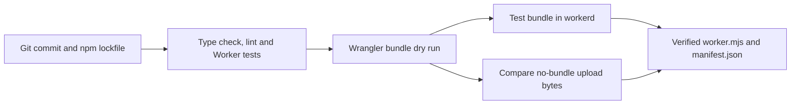

# Worker CI action

Build and test a Cloudflare Worker from a specific Git commit. The action returns
the verified JavaScript module and a manifest for one deployment target.

Use the action from a read-only GitHub Actions job. It sets up Node 24.19.0 and
Bun 1.4.3 and installs dependencies from the npm lockfile. The project supplies
its tests and Wrangler configuration. The pilot runs with synthetic service
bindings and no Cloudflare credentials.

[Set up a project and call the action](docs/usage.md) ·
[Release workflow](https://github.com/vhco-pro/worker-release-workflow) ·
[Example release](https://github.com/vhco-pro/vhco-contact/releases/tag/v0.1.0)
